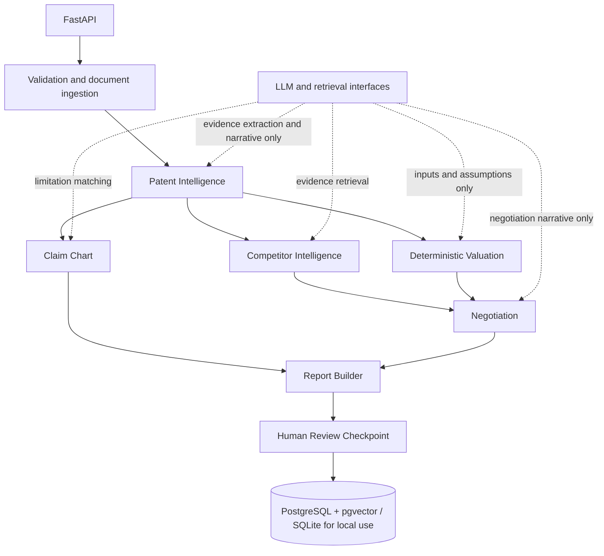

# Skits Strategos Backend

A runnable FastAPI scaffold for patent assessment, valuation, licensing strategy, and report generation. The project keeps AI-assisted extraction and narrative separate from deterministic calculations. Placeholder modules deliberately return reviewable outputs; they do not claim to establish a licensing target or a legal conclusion.

## Run locally

Requires Python 3.12. Create a virtual environment, then run:

```bash
python -m venv .venv
# Windows PowerShell: .venv\Scripts\Activate.ps1
# macOS/Linux: source .venv/bin/activate
pip install -r requirements.txt
uvicorn app.main:app --reload
```

The default database is a local SQLite file (`./skits_strategos.db`). Set `DATABASE_URL` in `.env` to use PostgreSQL. The API is documented at `http://127.0.0.1:8000/docs`; `GET /health` checks service availability.

Create an assessment with `POST /api/v1/assessments`, optionally upload raw document bytes to `POST /api/v1/assessments/{id}/documents?filename=patent.pdf`, add screen 2 information with `PUT /api/v1/assessments/{id}/commercial-info`, then start it with `POST /api/v1/assessments/{id}/start`. The scaffold completes the placeholder workflow inline and returns its reviewable result.

## Docker

```bash
docker compose up --build
```

The compose file starts the API and `pgvector/pgvector:pg16`. The API waits for the database health check. Local development can use SQLite without Docker.

## Tests

```bash
pytest
```

## Architecture



The workflow fans out from Patent Intelligence: Competitor Intelligence, Claim Chart, and Valuation run as parallel branches. Negotiation waits for Competitor Intelligence and Valuation. Report generation waits for Negotiation and Claim Chart, then the workflow reaches a human-review checkpoint. AI output schemas carry confidence, evidence, and a review flag. Numeric valuation calculations are implemented in Python and never delegated to the LLM.

### Claim chart review criteria

- **STRONG**: direct, traceable evidence supports every material element of the limitation for the identified product or document.
- **PARTIAL**: evidence supports some elements, while at least one material element is missing or ambiguous.
- **GAP**: no reliable evidence supports the limitation, or the available evidence indicates a material mismatch.

These are evidence triage labels, not infringement conclusions. Every row is reviewable, and a qualified human must validate the evidence, product mapping, and label.

### Patent Strength Score

The score is a weighted mean on a 0–100 scale: novelty 25%, claim breadth 25%, legal status 20%, evidence quality 15%, and commercial relevance 15%. Only supplied dimensions are included, with their weights renormalized; if no dimension is supplied, the score is unavailable. The score is an expert-input rubric and not an automated legal opinion.

## Project layout

- `app/api`: HTTP endpoints and request-scoped database wiring.
- `app/ingestion`: format dispatch and lazy PDF, OCR, and DOCX adapters.
- `app/ai`: replaceable LLM, embedding, retrieval, and reranking interfaces.
- `app/modules`: plain Python services for the five assessment domains.
- `app/workflows`: parallel assessment graph and workflow state tracking.
- `app/database`: SQLAlchemy models, session factory, and repositories.
- `app/reports`: report assembly from module outputs.
- `tests`: schema, API, calculations, and workflow checks.

## Licences to verify

Check current project and model licences before commercial deployment. This list is a review prompt, not legal advice.

- [ ] FastAPI, Pydantic, pydantic-settings, SQLAlchemy, Alembic, LangGraph, NumPy, SciPy, Pandas
- [ ] PyMuPDF, Docling, python-docx, pytesseract, Tesseract OCR binary, and spaCy/model packages if enabled
- [ ] Hugging Face Transformers, Sentence Transformers, and the selected Qwen3 Instruct model weights
- [ ] `cross-encoder/ms-marco-MiniLM-L-6-v2` model weights
- [ ] PostgreSQL and the pgvector extension/image
- [ ] Patent, company, and comparable-agreement data providers and their data-use terms

## Implementation boundary

Patent extraction, semantic retrieval, reranking, LLM matching, and narrative generation are interfaces or placeholders. Competitor candidates must carry commercial activity evidence and commercial relevance evidence in addition to patent similarity. Claim chart labels require human review. `app/modules/valuation/calculations.py` contains deterministic methods and Monte Carlo simulation; `engine.py` only assembles their results and records assumptions.

## Next steps

1. Add secure document storage, malware scanning, size limits, and OCR/layout extraction evaluation.
2. Connect a patent data source and build evidence-grounded Patent Intelligence with provenance tests.
3. Add retrieval corpora and independently validate competitor eligibility and claim-chart review criteria.
4. Define finance-input provenance and calibrate valuation assumptions with domain experts; keep the calculation engine deterministic.
5. Add authentication, tenant isolation, audit retention, and operational monitoring before deployment.
